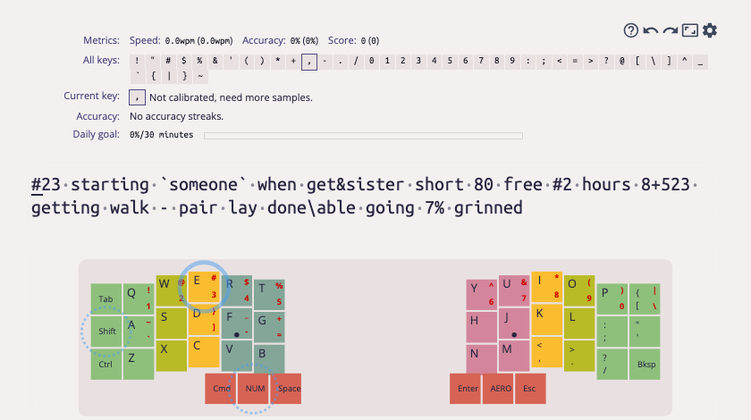

# keybr for split keyboards (fork)

This is a fork of [keybr.com](https://github.com/aradzie/keybr.com) by Aliaksandr Radzivanovich,
adapted for learning to type on split / columnar keyboards with layers (Corne and other ZMK boards).
Everything below this section is the original README.

<p align="center">
    
</p>

### What it adds

* **Your ZMK keymap as the virtual keyboard.** Upload your `.keymap` (and optionally the
  physical layout `.json` from ZMK Studio / QMK `info.json`) in *Settings → Keyboard*.
  A "ZMK config" geometry appears for every language: the base layer gives the keys (joysticks
  and encoders are skipped), characters from held layers are drawn on the physical keys they share,
  and the key hint shows which layer key to hold. Supports `&kp`, `&mo`, `&lt`, `&mt`, custom
  hold-taps (home row mods), tap-dances, macros that hold a layer, `LS()` and `#define`d layers.
* **A "Symbols & layers" lesson.** Digits and punctuation mixed with real words, so you practice
  switching to the layer and back. Slow and error-prone symbols show up more often.
* **An adaptive guided mode** (on by default, can be switched off):
  * key confidence counts errors, not only speed;
  * the focused key is chosen by *current* performance weighted by letter frequency,
    so frequent letters that regressed get trained again;
  * a slow key cannot block new letters forever: after a configurable number of lessons
    the next letter is unlocked if the alphabet is good on average;
  * lessons use real dictionary words weighted by your weak letters, without forcing
    the focused letter into every word;
  * **bigrams**: per-transition timing and errors are collected from your keystrokes,
    with a prior from the keyboard geometry (same-finger and row-jumping pairs on a columnar
    board) until there is enough data;
  * **mistypes**: which key you press instead of the right one (e.g. the old row-stagger habit);
    words that contain both letters are used to train telling them apart;
  * the target speed grows with you once all letters are unlocked.
* **Data import/export** on the profile page, including bigram and mistype statistics.
* The current weak bigrams, mistypes and target are shown on the practice screen.
* Letters that live on a held layer (like Russian ё/ъ on a Corne) can be skipped in guided lessons.

Tested with English (QWERTY) and Russian (ЙЦУКЕН) on an Eyelash Corne. There are no ads in this fork.

### Run it locally

You need Node.js 26 (see [Getting started](./docs/getting_started.md) for details).

```shell
git clone -b corne-ru https://github.com/punjet/keybr.com.git
cd keybr.com
npm install
cp .env.example .env
npm run compile && npm run build-dev
./packages/devenv/lib/initdb.ts
npm start   # http://localhost:3000
```

Then open *Settings → Keyboard*, pick your language and layout, and upload your ZMK `.keymap`.

### Tools

`packages/keybr-lesson/tools/` has two scripts that replay a downloaded `typing-data.json` through
the original and the adaptive algorithms (when letters unlock, what texts look like):

```shell
cd packages/keybr-lesson
REPLAY=~/Downloads/typing-data.json npx tstest --import=@keybr/test-env-bundler --test tools/replay.test.ts
REPLAY=~/Downloads/typing-data.json npx tstest --import=@keybr/test-env-bundler --test tools/compare.test.ts
```

Same license as the original: GNU AGPL v3.0.

---

[](https://github.com/aradzie/keybr.com/actions/workflows/ci.yml)

# [keybr.com](https://www.keybr.com/) is not (just) a typing test

<p align="center">
    
</p>

It's the smartest way to learn touch typing and improve your typing speed.
On the surface, it looks pretty simple: it shows you a piece of text, and you type it out.
But the devil is in the details — keybr.com offers a few unique features:

* keybr.com tracks every single keystroke and computes statistics for each individual key.
* It automatically generates lessons that focus on your weakest keys.
* You can set your own target typing speed, and it tracks your progress toward that goal.
* It starts with a small set of the most frequent letters in your language.
* More letters are added once you reach the target speed with the current ones.
* It can even predict how many more lessons you will need to complete to reach your target speed.
* It provides a beautiful profile page with detailed graphs showing your learning progress.
* It offers plenty of modes and configuration options.

<p align="center">
    
</p>

## Can I contribute?

Yes!

* **[Give us a ⭐️.](https://github.com/aradzie/keybr.com)** Help this project gain visibility and stand out.
* **[Report a bug.](https://github.com/aradzie/keybr.com/issues)** If something is not working, let us know.
* **[Suggest a feature.](https://github.com/aradzie/keybr.com/issues)** We are open to new ideas.
* **[Translate.](./docs/translations.md)** If you want to see keybr.com in your language.
* **[Getting started.](./docs/getting_started.md)** Launch a local instance of keybr.com, make a pull request.
* **[Add a keyboard.](docs/custom_keyboard.md)** Add a custom keyboard to keybr.com
* **[Add a language.](docs/custom_language.md)** Add a custom language to keybr.com
* **[Join our Discord server](https://discord.gg/gY4RA4enVH).** To discuss things in a less formal way.

## License

Released under the GNU Affero General Public License v3.0.
